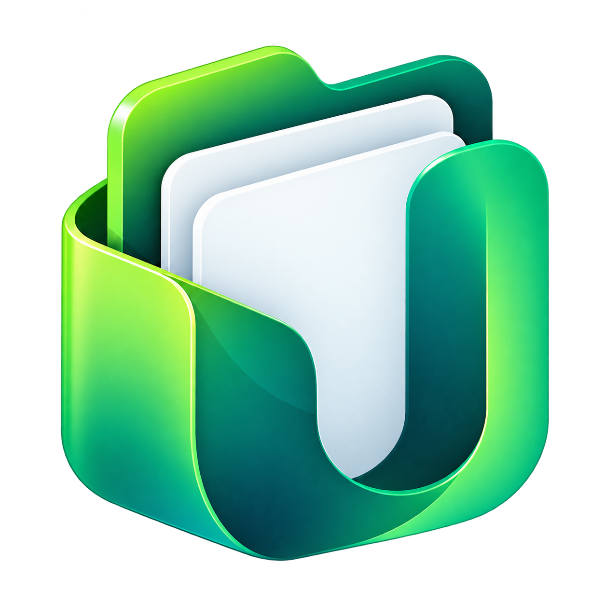

  

  <h1>UDrive — Desktop Client</h1>

  
<strong>File synchronization and cloud browsing for Unity Workspace</strong>

  

    
    
    
    
  

---

## Table of Contents

- [Table of Contents](#table-of-contents)
- [Overview](#overview)
- [Features](#features)
- [Platform and download status](#platform-and-download-status)
- [Connecting to your server](#connecting-to-your-server)
- [Development](#development)
  - [Build tools and configuration](#build-tools-and-configuration)
- [Implementation notes and current limits](#implementation-notes-and-current-limits)
- [Reporting issues and contributing](#reporting-issues-and-contributing)
- [License](#license)

---

## Overview

UDrive is the Unity Workspace desktop client, customized from the
[ownCloud Desktop Client](https://github.com/owncloud/client). It combines the
existing sync engine with a UDrive file browser, branding and navigation that
follow the UDrive web interface.

This is a **C++/Qt application** built with CMake and KDE Craft. Python runs the
build tooling; the application itself is written in C++ and QML.

## Features

- Browse Personal files, Workspaces, Shares, Favorites and Deleted files.
- Navigate folders through clickable breadcrumbs and search the current folder.
- Switch between default table, condensed table and tile views.
- Sort by Recent, A–Z, Z–A, Newest, Oldest, Largest or Smallest. Recent tracks
  files opened in the desktop app; Newest and Oldest use modified dates.
- Create folders, upload, download, rename, copy, move, favorite, delete and
  restore files, subject to the server's permissions.
- Permanently delete items from Deleted files after an explicit confirmation
  tied to the original account, space, item and listed revision.
- Show authenticated image thumbnails when the server provides previews.
- Preview PDFs inside UDrive on macOS, with page navigation, fit modes and zoom.
- Connect multiple accounts with separate file views, requests, thumbnail caches
  and recent-file histories.
- Manage synchronization, view activity and open the selected space online.
- Use light or dark appearance and three UI languages: English, Khmer and
  Simplified Chinese.

Language changes take effect after fully quitting and reopening UDrive. Some
upstream diagnostics and system dialogs can still use English.

## Platform and download status

| Platform             | Current status in this fork                                                                                                                             |
| -------------------- | ------------------------------------------------------------------------------------------------------------------------------------------------------- |
| macOS, Apple Silicon | Development build and UDrive regression tests verified locally. A distributable installer still needs to be prepared.                                   |
| Windows, x64         | Existing build and packaging workflow is configured. The customized UDrive build has not yet been built and tested on Windows in this development work. |
| Linux, x64           | Existing build workflow is configured. The customized UDrive build has not yet been verified on Linux in this development work.                         |
| macOS, Intel         | Not verified for the current UDrive customization. Requires a separate compatible build.                                                                |

This README does not provide a published UDrive installer. Upstream ownCloud
downloads contain the upstream product, not this customized UDrive client.

A Mac `.app` or `.dmg` cannot run on Windows. Windows users need a separate
Windows installer. In-app PDF preview currently depends on macOS CoreGraphics;
other platforms retain the existing external-open/download behavior.

## Connecting to your server

1. Start UDrive and choose **Add account**.
2. Enter your compatible ownCloud Infinite Scale server's HTTPS address.
   For Unity Workspace, the production address is
   `https://drive.unity-workspace.com`.
3. Complete sign-in in the browser and return to UDrive.
4. Use the file browser, or open **Sync** to manage local synchronized folders.

The server and identity provider must be reachable from the user's computer.
For Keycloak, register the desktop client's configured client ID and allow its
loopback callback. The OAuth `redirect_uri` returns to the desktop client; it is
not the UDrive website address. Sign-in uses Authorization Code with S256 PKCE.

The upstream 7.1.x client targets ownCloud Infinite Scale. Support for PHP
ownCloud Server 10 was removed in 7.1.0; see [CHANGELOG.md](CHANGELOG.md).

## Development

### Build tools and configuration

The project uses CMake, Qt 6.8 and KDE Craft. The dependency configuration pins
Qt 6.8.3 and other libraries in [.craft.ini](.craft.ini) and
[.craft.shelf](.craft.shelf). Additional CI options are in
[craft_override.ini](.github/workflows/craft_override.ini).

Use Apple Clang on macOS, MSVC on Windows, or GCC on Linux. Install the
dependencies before configuring CMake; installing Qt Creator alone does not
provide the project's dependency set.

For a fresh clone, follow the [KDE Craft setup guide](https://community.kde.org/Craft)
and the repository's [build workflow](.github/workflows/main.yml). Configure
Craft's `owncloud/owncloud-client` package with `srcDir` pointing to this checkout
so it compiles the UDrive fork. The workflow contains dependency, build, test
and packaging stages for the configured platform targets.

The default theme is selected from [branding/](branding/) by
[THEME.cmake](THEME.cmake). Branding details are documented in
[branding/README.md](branding/README.md).

## Implementation notes and current limits

- Global search, bulk selection and full sharing-permission management are not
  implemented in this desktop browser. Use **Open on Web** from an item's menu
  or visit the UDrive website for web-only features.
- Image previews use a bounded, per-account memory cache and two shared
  request/decode slots. Previews are not stored on disk.
- macOS PDF preview supports files up to 100 MiB. A supervised helper applies a
  five-second render timeout and a 4096-pixel raster bound. This is a killable
  process boundary, not an OS sandbox or a hard memory limit. PDF text search,
  annotations and printing are not implemented.
- File writes can retry once after a definitive HTTP 401 and credential refresh.
  Ambiguous failures are not replayed automatically. Refresh the listing after
  an unconfirmed operation to inspect the server's state.

## Reporting issues and contributing

Report UDrive-specific issues and propose changes in this fork's repository.
Include the platform, build version, reproduction steps and relevant sanitized
diagnostics. Do not include passwords, access/refresh tokens or private file
contents in reports.

For upstream history, contributors and changes, see
[ownCloud/client](https://github.com/owncloud/client) and
[CHANGELOG.md](CHANGELOG.md). UDrive retains the upstream copyright and license
notices.

## License

This project is distributed under the **GNU General Public License, version 2
or later**. See [COPYING](COPYING) and the individual source-file notices.
Documentation licensing is recorded in
[COPYING.documentation](COPYING.documentation).

This program is distributed in the hope that it will be useful, but **without
any warranty**, including the implied warranties of merchantability or fitness
for a particular purpose.
